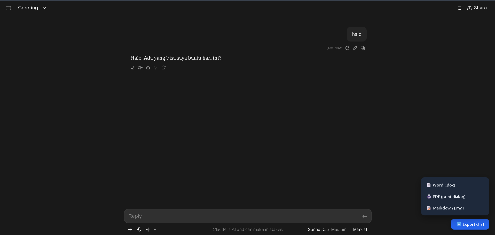
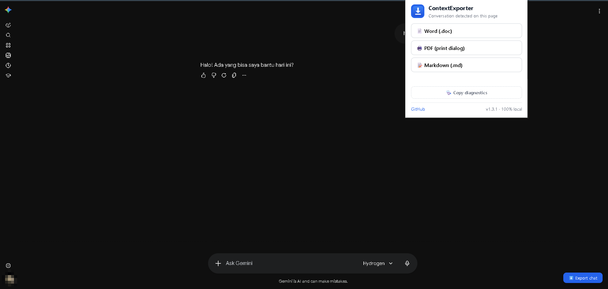
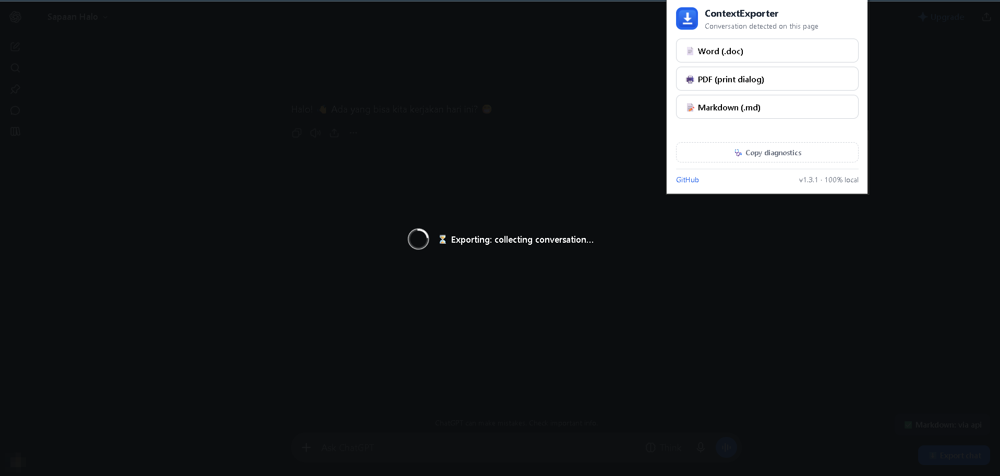
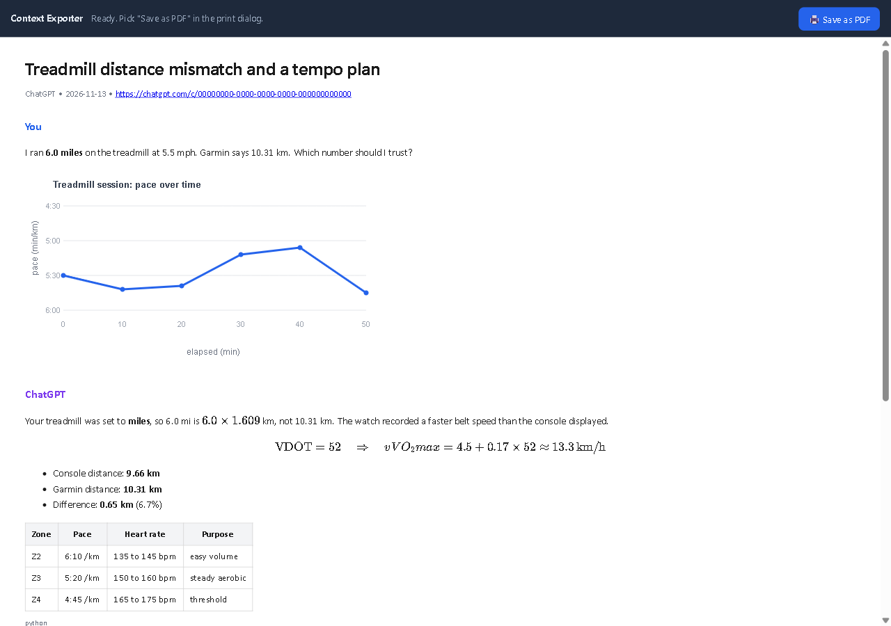
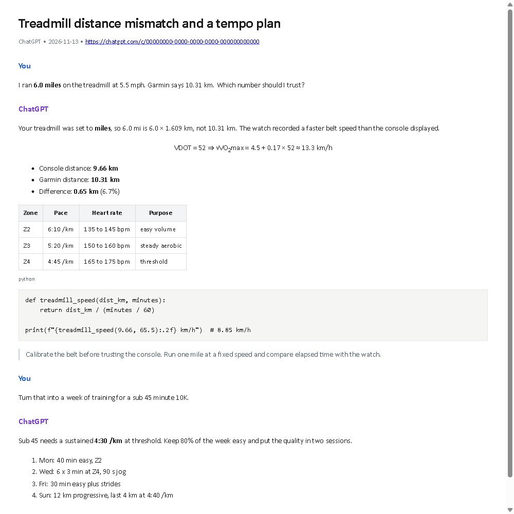
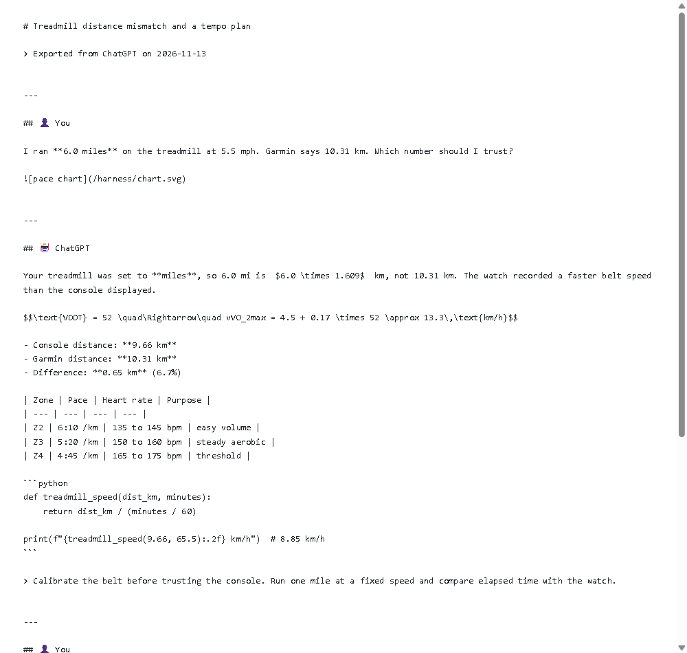

  <picture>
    <source media="(prefers-color-scheme: dark)" srcset="assets/logo-dark.png">
    
  </picture>

Free and open source Chrome extension that exports a full conversation session (top to bottom) from **ChatGPT**, **Claude**, and **Gemini** to **Word (.doc)**, **PDF**, and **Markdown**.

Everything runs locally in your browser: no account, no server, no tracking.

## What it does

- Exports the **entire conversation**, not just the visible messages:
  - **ChatGPT and Claude** read the conversation through the site's own API, so a long thread exports in about a second without scrolling. If those endpoints are unavailable, they fall back to harvesting the virtualized thread while scrolling.
  - **Gemini** drives its lazy history loader to the top while collecting every mounted window, then orders the turns.
- Keeps **code blocks, tables, lists, quotes, and links** intact.
- **Embeds images** into the file, so nothing breaks when the original CDN links expire. Thumbnails are downscaled to keep exports small.
- Handles **math**: PDF shows it fully rendered (bundled KaTeX), Word gets a readable plain-math approximation, Markdown keeps the raw LaTeX.
- One floating button on the chat page, plus the same options in the toolbar popup.

| Format | How it works | Notes |
|--------|--------------|-------|
| Word (.doc) | Word-flavoured HTML that Word and Google Docs open natively | Tables embedded; math approximated. See the Word image note under Limitations |
| PDF | Opens a preview page, then Chrome's own print dialog | Pick "Save as PDF" as destination. Math renders with bundled KaTeX |
| Markdown (.md) | Clean markdown source | Math becomes `$...$` / `$$...$$`, code becomes fenced blocks |

## Screenshots

*The floating **Export chat** button opens the format menu on any supported site.*

*The toolbar popup detects the conversation and offers the same three formats.*

*A full-screen overlay collects the conversation behind it, so no scrolling is visible.*

## What the exports look like

Same sample conversation exported three ways.

*PDF: the preview page renders math with the bundled KaTeX, then Chrome prints it.*

*Word: the same conversation as a `.doc`, with headings, tables, and math in plain notation. Word does not render embedded images, so they are left out here too.*

*Markdown: clean source with fenced code, pipe tables, and the raw LaTeX kept intact.*

## Platform support

| Site | Source | Status |
|------|--------|--------|
| ChatGPT | Backend API first, DOM fallback | Stable |
| Claude | Page API first, virtualized DOM fallback | Working |
| Gemini | DOM scraping | Working, selectors may need updates when the site changes |

Site markup changes often. Each site has its own adapter, so one broken adapter never affects the other two. The popup includes a diagnostics dump (DOM markers, extraction preview, backend requests) that makes adapter fixes quick.

## Install

### From source (works today)

1. Download this repository (`Code` > `Download ZIP`, or `git clone`), then unzip it.
2. Open `chrome://extensions`.
3. Turn on **Developer mode** (top right).
4. Click **Load unpacked** and select the folder containing `manifest.json`.

### From a release zip (no build step)

1. Open the [Releases](https://github.com/albiruby/ContextExporter/releases) page and download the latest `ContextExporter-*.zip`.
2. Unzip it anywhere.
3. Open `chrome://extensions`, turn on **Developer mode**, click **Load unpacked**, and select the unzipped folder (the one containing `manifest.json`).

Updates arrive the same way: download the new zip, unzip over the old folder, then click the reload icon on the extension card.

## Usage

1. Open any conversation on chatgpt.com, claude.ai, or gemini.google.com.
2. Click the blue **Export chat** button in the bottom right corner (or use the extension popup).
3. Choose Word, PDF, or Markdown.
4. A full-screen overlay shows progress while the conversation is collected; the file downloads or the PDF preview opens when it is done.

## How it works

- A small **adapter per site** finds the message nodes and normalizes them into one intermediate document format (paragraphs, headings, code, tables, images, math, lists).
- On ChatGPT and Claude the site's **own conversation endpoint** is used first: one paginated JSON request per conversation page. The **scroll engine** remains as a fallback for accounts where that endpoint is unavailable.
- **Exporters** turn the intermediate document into Markdown, Word HTML, or the PDF preview document.
- Images are fetched, downscaled, converted to data URLs, and embedded. `blob:` images are read in the page itself; CDN images go through the service worker.

## Limitations

- **Word images**: a `.doc` file is HTML opened by Word, and Word does not render base64 images. Embedded images may not appear in Word (PDF and Markdown show them fine). A real `.docx` writer with media files is on the roadmap.
- **Link-card icons and unknown CDNs** stay as URLs instead of being embedded. Only the chat sites and their own image CDNs are covered by host permissions.
- **Claude artifacts** are not exported (only the conversation text).
- **Claude attachments**: the API path lists uploaded files by name instead of embedding them. The virtualized-DOM fallback includes the images.
- **Fallback scrolling** happens behind a full-screen overlay and can take a few seconds on very long threads.
- Word math output is an approximation (superscripts, symbols, fractions written as `a / b`), not a full equation editor conversion.
- The PDF path goes through Chrome's print dialog rather than generating a file directly, which keeps the extension small and dependency free.

## Privacy

The extension has no backend. Conversation content is read from the page you are on, kept in memory, and written to the file you download. Nothing is uploaded, logged, or shared.

Permissions used:

- `downloads`: to save the exported file
- `storage`: to hand the PDF preview document to the preview page
- host permissions: the three chat sites and their image CDNs, so images can be embedded

## Roadmap

- `.docx` export with embedded media (fixes Word images)
- Claude artifacts

## Contributing

Bug reports and pull requests are welcome, especially adapter fixes when a site changes its markup. See [CONTRIBUTING.md](CONTRIBUTING.md).

## License

[GPL-3.0](LICENSE). If you fork or redistribute this project, your version must stay open source under the same license.
